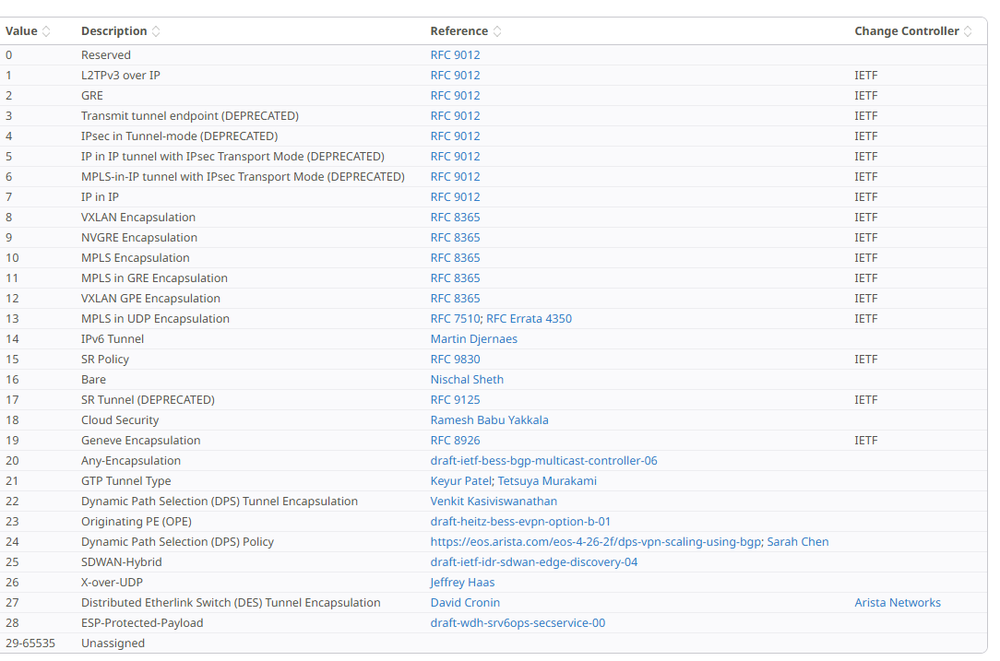
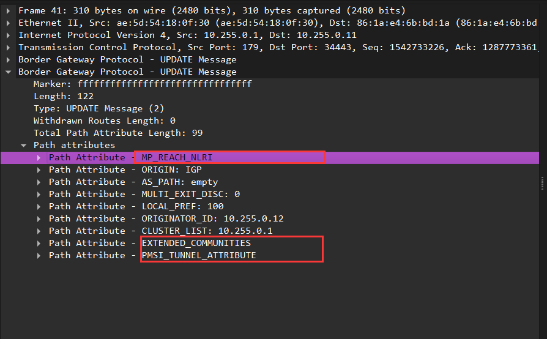
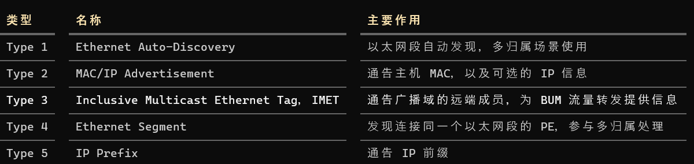
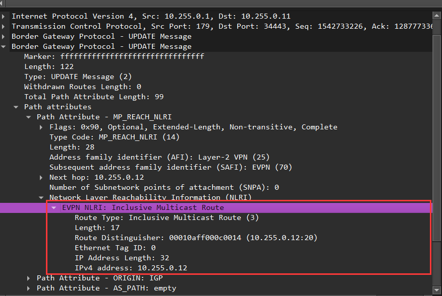
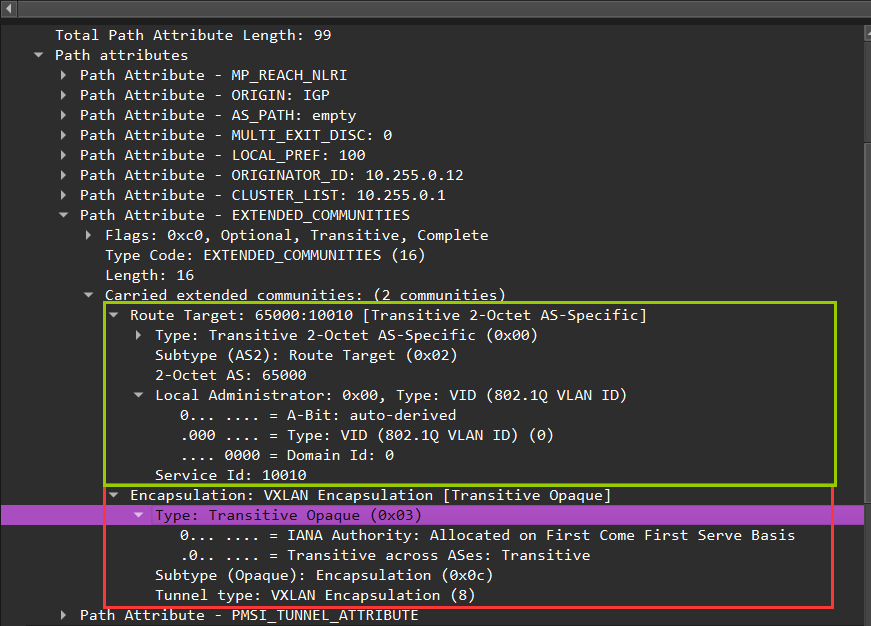
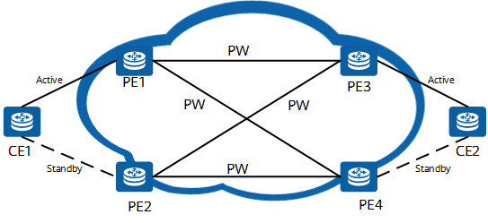
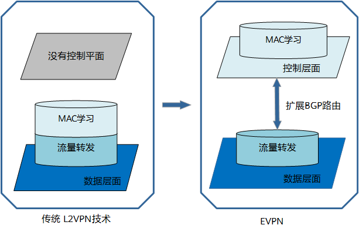
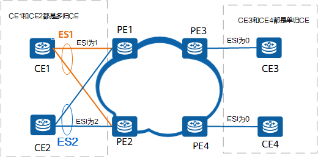
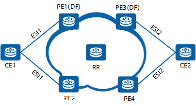
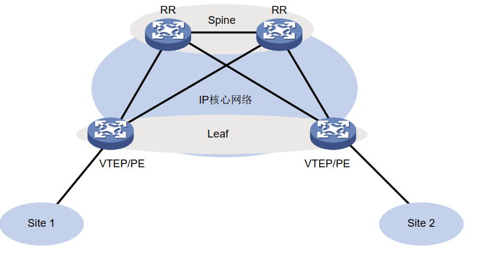

### 1. evpn概念

EVPN（Ethernet Virtual Private Network）是下一代全业务承载的VPN解决方案。EVPN统一了各种VPN业务的控制面，利用BGP扩展协议[mp-bgp]来传递二层或三层的可达性信息，实现了转发面和控制面的分离。
EVPN解决传统L2VPN的无法实现负载分担、网络资源的消耗较高等不足，同时也可以对L3VPN业务进行承载，降低了协议的复杂程度。EVPN还将IP VPN流量均衡和部署灵活的优势引入到了以太网中。种种优势使其广泛应用于大型数据中心二层网络互连场景，

EVPN是下一代全业务承载的VPN解决方案，它颠覆了传统二层VPN通过转发面来学习MAC地址的机制，`引入了控制面`，利用BGP扩展协议来传递MAC信息。EVPN基于MP-BGP，定义了一系列新的BGP EVPN路由类型，从而使EVPN网络中的不同站点间可以相互学习MAC地址信息。

#### 1.1 术语

##### 1.1.1 网络架构与设备角色

| 术语 | 全称 / 中文 | 含义 | 本实验对应 |
|---|---|---|---|
| **EVPN** | Ethernet VPN，以太网 VPN | 通过 BGP 分发 MAC、IP、广播域成员等信息，构建二层及三层 VPN | 控制面协议 |
| **VXLAN** | Virtual eXtensible LAN | 将内层以太网帧封装到 UDP/IP 中传输 | 数据面封装，UDP 4789 |
| **Underlay** | 底层网络 | 提供 VTEP IP 之间的可达性 | Leaf–Spine 之间的 OSPF 网络 |
| **Overlay** | 叠加网络 | 在底层 IP 网络上构建逻辑二层、三层网络 | VXLAN 租户网络 |
| **VTEP** | VXLAN Tunnel Endpoint | 执行 VXLAN 封装和解封装的端点 | Leaf1 `10.255.0.11`、Leaf2 `10.255.0.12` |
| **NVE** | Network Virtualization Edge | 网络虚拟化边缘节点；在 VXLAN 场景中通常承担 VTEP 功能 | 两个 Leaf |
| **PE** | Provider Edge | 提供 VPN 服务的边缘设备 | 两个 Leaf 承担 EVPN PE 角色 |
| **CE** | Customer Edge | 客户侧设备，连接到 PE | 可以是客户路由器、交换机或主机 |
| **RR** | Route Reflector，路由反射器 | 反射 iBGP 路由，减少全互联需求 | Spine `10.255.0.1` |

##### 1.1.2 网络实例与转发表

| 术语 | 全称 / 中文 | 含义 | 本实验对应 |
|---|---|---|---|
| **VNI** | VXLAN Network Identifier | VXLAN 的 24 bit 网络标识 | `10010`、`10020`、`50000` |
| **L2VNI** | 二层 VNI | 标识二层转发域，用于同网段通信 | `10010`、`10020` |
| **L3VNI** | 三层 VNI | 标识租户 IP-VRF，用于对称 IRB 的跨网段传输 | `50000` |
| **EVI** | EVPN Instance | 跨多个 PE 的逻辑 EVPN 服务实例 | 本实验采用每个 L2VNI 对应一个 EVI 的模型 |
| **BD** | Bridge Domain，桥接域 | 一个二层广播域 | `br10`、`br20` 分别承载两个 BD |
| **MAC-VRF** | MAC 转发实例 | 隔离二层桥接和 MAC 转发表；与 BD 的关系取决于服务模型 | 分别服务于 L2VNI 10010、10020 |
| **IP-VRF** | IP 路由转发实例 | 独立的 IP 路由和转发空间 | `TENANT-A`，Linux 路由表 1001 |
| **SVI** | Switched Virtual Interface | 广播域对应的三层接口，可承担网关功能 | `br10` 上的 `192.168.10.254` 等 |
| **FDB** | Forwarding Database | MAC 转发表，记录 MAC 对应的端口或远端转发信息 | Linux bridge 的 MAC 表 |

##### 1.1.3 BGP 路由通告中的术语

| 术语 | 全称 / 中文 | 含义 | 本实验对应 |
|---|---|---|---|
| **MP-BGP** | Multiprotocol BGP | 通过地址族支持多种路由信息 | 承载 EVPN 路由 |
| **AFI / SAFI** | 地址族 / 后续地址族标识 | 共同确定路由信息的类别 | EVPN 为 **25 / 70** |
| **NLRI** | Network Layer Reachability Information | 路由可达性信息；EVPN NLRI 有专门的路由类型与编码 | Type 2、Type 3 等 |
| **RD** | Route Distinguisher，路由区分符 | 区分不同实例产生的路由 | `10.255.0.11:10` |
| **RT** | Route Target，路由目标 | 用于控制路由导入哪些 VPN 实例 | `65000:10010`、`65000:1` |
| **ESI** | Ethernet Segment Identifier | 10 字节的以太网段标识，主要用于多归属 | 本实验单归属，ESI 为 0 |
| **Ethernet Tag ID** | 以太网标签标识 | EVPN NLRI 中用于标识服务内广播域的字段，具体语义取决于服务模型 | 本实验为 0 |
| **IMET** | Inclusive Multicast Ethernet Tag | EVPN Type 3 路由，通告广播域成员信息 | 当前 Spine 表中的四条 Type 3 |
| **Encapsulation Type** | 封装类型 | 扩展团体中描述使用何种数据封装 | FRR 显示 `ET:8`，表示 VXLAN |

`RD 用于区分路由，RT 用于控制导入`。 此外，`ET:8` 的 ET 表示封装类型，

##### 1.1.4 网关与转发机制

| 术语 | 中文 | 含义 / 本实验对应 |
|---|---|---|
| **IRB** — Integrated Routing and Bridging | 集成路由与桥接 | 在 PE 上同时实现同网段二层转发和跨网段三层转发 |
| **Symmetric IRB** | 对称 IRB | 入口、出口 PE 都执行路由；本实验跨网段流量使用 L3VNI 50000 |
| **Asymmetric IRB** | 非对称 IRB | 入口 PE 完成路由，再通过目标广播域的 L2VNI 发送，出口 PE 执行二层转发 |
| **Anycast Gateway** | 任播网关 | 多个 Leaf 为同一网段提供相同的网关 IP/MAC，使主机就近接入网关 |
| **Router MAC / RMAC** | 路由器 MAC | 对称 IRB 隧道内使用的 PE 路由 MAC，例如 Leaf2 的 `02:00:00:00:ff:12` |
| **BUM** | 广播、未知单播、组播 | Broadcast、Unknown Unicast、Multicast 的合称 |
| **Ingress Replication / HER** | 入口复制 / 头端复制 | 入口 VTEP 将需要泛洪的报文复制给相关远端 VTEP |
| **ARP/ND Suppression** | ARP/ND 抑制 | 利用已知 IP–MAC 绑定代答查询，减少广播或组播泛洪 |
| **PMSI Tunnel Attribute** | PMSI 隧道属性 | 描述 BUM 使用的隧道方式、标签/VNI 和端点；本实验包含 `Ingress Replication` |

##### 1.1.5 多归属场景常见术语

| 术语 | 含义 |
|---|---|
| **ES — Ethernet Segment** | 一个客户站点或设备连接到一个或多个 PE 的以太网链路集合 |
| **Multihoming** | 客户设备同时连接多个 PE，提供冗余或负载分担 |
| **DF — Designated Forwarder** | 多归属场景中，负责向该以太网段转发指定业务 BUM 流量的 PE |
| **All-Active** | 全活模式，多个 PE 可以共同转发该业务的已知单播流量 |
| **Single-Active** | 单活模式，对某个业务由一个 PE 承担转发，其他 PE 备份 |
| **Split Horizon** | 水平分割，防止从某个以太网段进入的流量又经其他 PE 返回同一段 |
| **MAC Mobility** | MAC 迁移，通过序列号等信息更新主机所在位置 |

##### 1.1.6 BGP隧道封装属性的隧道类型



#### 1.2 EVPN 对BGP的拓展

EVPN 的主要扩展是：定义 EVPN NLRI，以及一组 EVPN 专用扩展团体。它通过已有的 MP-BGP 路径属性来携带这些信息。

要区分三个层级：**BGP 路径属性 → EVPN 路由类型 → 扩展团体类型**。

##### 1.2.1 EVPN使用的BGP路径属性

主要是BGP的update报文的Path attributes 新增一些属性来标识EVPN信息

| BGP 路径属性 | Type Code | 在 EVPN 中的作用 | 属性分类 | 来源 |
|---|---:|---|---|---|
| **MP\_REACH\_NLRI** | **14** | 通告 EVPN 路由及下一跳 | 可选非过渡 | MP-BGP 定义 |
| **MP\_UNREACH\_NLRI** | **15** | 撤销 EVPN 路由 | 可选非过渡 | MP-BGP 定义 |
| **EXTENDED\_COMMUNITIES** | **16** | 携带 RT、封装类型、Router MAC、MAC Mobility 等 | 可选过渡 | 复用扩展团体属性 |
| **PMSI\_TUNNEL\_ATTRIBUTE** | **22** | 配合 Type 3，通告 BUM 流量的隧道信息、复制方式和标签/VNI | 可选过渡 | 复用 MVPN 定义的属性 |

因此，**14、15、16、22 都是 EVPN 使用的路径属性，不能全部算作“EVPN 新增的属性编号”**&#12290;相关定义分别来自 [RFC 4760](<https://datatracker.ietf.org/doc/html/rfc4760>)、[RFC 4360](<https://www.rfc-editor.org/rfc/rfc4360.html>)和 [RFC 6514](<https://www.rfc-editor.org/rfc/rfc6514.html#section-5>)。



###### 1.2.1.1 PMSI_TUNNEL_ATTRIBUTE属性

**PMSI\_TUNNEL\_ATTRIBUTE 用来通告：某个 EVPN 广播域的 BUM 流量，应采用什么隧道方式、携带什么标签，以及发往哪个隧道端点。**

BUM 指广播、未知单播和组播。在你的 VXLAN 实验中，这个属性随 **EVPN Type 3 路由**一起发布，用于建立远端 VTEP 的泛洪复制列表。

PMSI 全称为 **P-Multicast Service Interface**，属性通常简称 **PTA**。它是独立的 BGP 路径属性：

报文格式:

完整属性分为 BGP 属性头和 PMSI 属性值：

```
┌────────────────────────────────┐
│ Attribute Flags       1 字节   │
├────────────────────────────────┤
│ Attribute Type Code   1 字节   │  22
├────────────────────────────────┤
│ Attribute Length    1/2 字节   │  属性值的长度
├────────────────────────────────┤
│ PMSI Flags            1 字节   │
├────────────────────────────────┤
│ Tunnel Type           1 字节   │
├────────────────────────────────┤
│ MPLS Label / VNI       3 字节   │
├────────────────────────────────┤
│ Tunnel Identifier     变长     │
└────────────────────────────────┘

BGP UPDATE
└── Path Attributes
    ├── MP_REACH_NLRI                  属性类型 14
    │   ├── AFI：25，L2VPN
    │   ├── SAFI：70，EVPN
    │   ├── Next Hop：10.255.0.12
    │   └── EVPN NLRI
    │       ├── Route Type：3，IMET
    │       ├── RD：10.255.0.12:10
    │       ├── Ethernet Tag ID：0
    │       └── Originating Router IP：10.255.0.12
    │
    ├── Extended Communities          属性类型 16
    │   ├── RT：65000:10010
    │   └── Encapsulation：VXLAN，值为 8
    │
    └── PMSI_TUNNEL_ATTRIBUTE         属性类型 22
        ├── Flags：0
        ├── Tunnel Type：6，Ingress Replication
        ├── VNI：10010
        └── Tunnel Identifier：10.255.0.12
```

`Tunnel Type` 决定 `Tunnel Identifier` 的格式。例如入口复制携带单播接收端点 IP；PIM 类隧道可以携带源地址、组播组地址等信息。[RFC 6514 §5](<https://www.rfc-editor.org/rfc/rfc6514.html#section-5>)


##### 1.2.2 EVPN的路由类型

主要是对MP-BGP的update报文的MP_[UN/]REACH_NLRI 进行了拓展，EVPN 定义了自己的地址族和路由编码：

```
MP_REACH_NLRI / MP_UNREACH_NLRI
└── AFI = 25，SAFI = 70
    └── EVPN NLRI
        ├── Route Type：1 字节
        ├── Length：1 字节
        └── 对应路由类型的内容
```

常见路由类型包括：

| EVPN Route Type | 携带的信息 |
|---:|---|
| 1 | Ethernet Auto-Discovery，以太网自动发现 |
| 2 | MAC/IP Advertisement，主机 MAC/IP |
| 3 | IMET，广播域成员信息 |
| 4 | Ethernet Segment，以太网段信息 |
| 5 | IP Prefix，IP 前缀 |

**这些 Type 1～5 是 EVPN 内部的路由类型编号，不是 BGP 路径属性编号。**

BGP EVPN路由有以下几种类型：



1. 以太自动发现路由（Ethernet Auto-Discovery Route）

    以太自动发现路由可以向其他的PE通告本端的PE对接入站点的MAC地址是否可达。主要用在快速收敛、冗余模式、别名和水平分割场景，解决多归属网络中的流量负载分担问题。

    ```
    能够用来在站点多归属组网中通告 ES 信息和 service ID 信息，也能够用来在 EVPN VPWS 组网中通告 service ID 信息。
    ```

2. MAC/IP地址通告路由（MAC/IP Advertisement Route）：

    站点的MAC和IP等信息是通过EVPN的MAC/IP地址路由通告的，因此不需要将ARP请求泛洪到网络之中，大大的减少了网络中的广播流量，减少了带宽资源的浪费

    ```
    用来通告 MAC 地址和主机路由信息（即ARP 信息和 ND 信息）
    ```

3. 集成多播路由（Inclusive Multicast Route）

    包含性组播以太网标签路由，又称为 IMET路由

    本端PE要向远端PE发送CE侧收到的广播、组播和未知的单播地址流量，需要集成多播路由发送多播地址可达信息来实现广播域内的成员互相发现。集成多播路由也要包含创建隧道的属性，PE设备之间，通过集成多播路由可以创建传递数据面流量的隧道。

    ```
    在EVPN VXLAN 组网中用来通告 VTEP 及其所属 VXLAN 信息，以实现自动发现 VTEP、 自动建立 VXLAN 隧道和自动关联 VXLAN 与 VXLAN 隧道；在 EVPN VPLS 组网中用来通告 PE 信息，实现 PE 的自动发现、自动建立 LSP。
    ```

4. 以太网段路由（Ethernet Segment Route）

    用来实现连接到相同CE和PE设备之间相互自动发现，该路由主要用于DF（Designated Forwarder，指定转发者）选举。由于CE多归于多个PE时，避免CE收到重复的流量，只需要有一个PE向CE转发BUM（Broadcast，Unknown Unicast，Multicast，广播、未知单播、组播流量统称），那么就需要在相同ES的PE之间，根据DF来选举出这个PE。

    ```
    用来通告 ES 及其连接的 VTEP 或 PE 信息
    ```

5. IP前缀路由（IP Prefix Route）

    用于EVPN网络接入外部网络。EVPN以IP前缀的形式通告引用的外部路由

    ```
    用来以 IP 前缀的形式通告 BGP IPv4 单播路由 或 BGP IPv6 单播路由。
    ```



##### 1.3 EVPN 定义的扩展团体类型

这些团体都放在 **EXTENDED\_COMMUNITIES（BGP 属性编号 16）** 内。下面列出基础 EVPN 及后续扩展中的常见项。

表中的 Type/Sub-Type 是**扩展团体内部的编号，采用十六进制**

| 扩展团体 | Type / Sub-Type | 作用 |
|---|---|---|
| **MAC Mobility** | `0x06 / 0x00` | 携带 MAC 迁移序列号和静态标记，帮助判断 MAC 的当前位置 |
| **ESI Label** | `0x06 / 0x01` | 携带以太网段相关标签及 Single-Active 标记，支持多归属、防环 |
| **ES-Import Route Target** | `0x06 / 0x02` | 控制同一以太网段相关 PE 导入 Type 4 路由 |
| **EVPN Router’s MAC** | `0x06 / 0x03` | 通告远端 PE 的 Router MAC，供对称 IRB 使用 |
| **Default Gateway** | `0x03 / 0x0d` | 标识通告的 MAC 是默认网关 MAC |
| **DF Election** | `0x06 / 0x06` | 通告多归属场景中的 DF 选举算法及相关能力 |

这些都是传递性扩展团体。其中 MAC Mobility、ESI Label、ES-Import、Default Gateway 在基础 EVPN 规范中定义；Router MAC、DF Election 来自后续扩展。[RFC 7432 §7.5–7.8](<https://www.rfc-editor.org/rfc/rfc7432.html#section-7.5>)、[RFC 9135 §8.1](<https://www.rfc-editor.org/rfc/rfc9135.html#section-8.1>)、[IANA EVPN 扩展团体注册表](<https://www.iana.org/assignments/bgp-extended-communities>)

EVPN 还复用了两类常见扩展团体：

- **Route target**：控制路由导入，例如 `RT:65000:10010`。
- **Encapsulation**：表示封装类型，例如 `ET:8` 表示 VXLAN。[RFC 8365](<https://www.rfc-editor.org/rfc/rfc8365.html#section-5.1.3>)



### 2. EVPN和传统L2VPN对比

#### 2.1 传统L2VPN面临的问题

以下以虚拟专用局域网服务VPLS（Virtual Private LANService）技术为例来介绍传统L2VPN所面临的挑战，VPLS是一种早期出现的MPLS VPN技术，被广泛的应用在用户数据中心互连场景，能为企业用户提供多点到多点的广域以太网服务。但是由于VPLS技术具有一定的局限性，使其无法满足大规模复杂数据中心的需求。



传统的L2VPN在数据中心互联网络部署拓扑图

- 网络部署难

    PE设备要学习所有CE设备的MAC地址，MAC的表容量是有限的。且由于存在大量的手工配置，对PE设备的规格要求很高。

- 适用的网络规模有限

    PE设备间需要建立全连接PW使VPLS不适合大规模网络。
    没有控制平面，一旦MAC地址变化或故障发生切换，需要重新泛洪学习L2转发表，收敛性差。

- 链路带宽利用率低

    为了避免CE侧到PE侧产生环路，CE侧到PE侧只支持单活模式，而不支持多活模式，这样就使得链路的利用率很低。

#### 2.2 EVPN技术带来的价值

EVPN技术有效地解决了上述问题：

- 如下图所示EVPN通过扩展BGP协议使MAC地址学习和发布过程从数据平面转移到控制平面。这样可以使设备在管理MAC地址时像管理路由一样，使目的MAC地址相同但下一跳不同的多条EVPN路由实现负载分担。

    
    EVPN技术与传统的L2VPN技术对比

- 通过使用EVPN技术，PE设备之间不再需要建立全连接。这是因为在EVPN网络中PE设备之间是通过BGP协议实现相互通信的。`BGP协议自带路由反射器功能，所以EVPN支持部署路由反射器，所有PE设备与反射器建立邻居关系，通过路由反射器来反射EVPN路由`，大大降低了网络复杂度，减少了网络信令数量。

- PE设备通过ARP协议和MAC/IP地址通告路由分别学习本地和远端的MAC地址信息以及其对应的IP地址，并将这些信息缓存至本地。当PE设备再收到其他ARP请求后，将先根据ARP请求中的目的IP地址查找本地缓存的MAC与IP地址的对应信息，如果查找到对应信息，PE将返回ARP响应报文，避免ARP请求报文向其他PE设备广播，减少网络资源消耗。

### 3. EVPN如何工作

#### 3.1 基础概念



EVPN基本概念示意图

- ES (Ethernet Segment)

    如果CE多归到两个或更多PE，这组CE接入到不同PE的以太链路集合就是一个ES。如上图所示，CE1归属于PE1和PE2，CE1分别到PE1和PE2的这两条以太网链路就是一个ES。

- ESI (Ethernet Segment Identifier)

    全局标识唯一一个ES的ID。如下图所示，不同PE连接相同CE设备的接口，需要有相同的ESI。当ESI的值为0时，表示PE连接的是个单归CE。

- EVI（EVPN Instance）

    表示EVPN实例，EVPN是虚拟化私网，在一台PE设备上存在多个EVPN实例。类似于VPLS的VSI，用来标识一个VPN客户。

- MAC-VRF

    用来存储EVPN实例通过BGP扩展协议学习到的MAC地址信息。每个EVI都有独立的MAC-VRF。

#### 3.2 EVPN的启动过程



EVPN网络拓扑图

如上图所示，EVPN的启动过程分为如下几个步骤：

1. 创建EVPN实例。

    为每个PE设备创建EVPN实例（即EVI），每个EVPN实例配置RD、RT属性。

2. 配置BGP对等体，并使能EVPN。

    PE设备会向邻居发送Type3路由。Type3路由包含RD和Label（MPLS分配）信息。

    当其他邻居设备收到报文时，会把路由信息放到本设备的BUM流量转发表，指导BUM报文转发，BUM即广播、未知单播、组播流量统称。

3. 绑定ESI到EVPN实例。

    1. ESI生成，并绑定ESI到EVPN实例。
    2. 然后触发Type4路由。Type4路由携带如下信息：RD 、ESI，PE源地址。
    3. Type4向对等体通告ESI被记录在ESI成员信息表中。

3. PE设备间互发Type1路由，更新ESI Label信息。

    完成DF选举之后，各PE之间会相互发布Type1路由，Type1路由携带的主要信息有：ESI值，以及本地为ESI分配的标签值。

各PE收到邻居发来的Type1路由之后，首先验证Type1路由携带的ESI值是否与本地相同，如果相同，就会把该路由携带的ESI标签值更新到本地的ES成员列表中。

### 4. EVPN的分层结构

如图 1-4 所示， EVPN 通常采用 Spine（核心） —Leaf（分支）的分层结构。 `Leaf 层的设备作为 VTEP
或 PE 对报文进行 EVPN 相关处理`； ``Spine 层为核心设备，根据报文的目的 IP 地址转发报文``。 EVPN
网络中的设备属于同一个 AS（Autonomous System，自治系统） 时， 为了避免 IBGP 对等体全连
接的问题，可以将`核心设备配置为 RR（Route Reflector，路由反射器）`。此时， RR 需要发布、接
收 EVPN 路由，但不需要封装、 解封装 VXLAN 或 MPLS 报文。

图1-4 EVPN 典型组网



### 5. EVPN的应用场景

1. EVPN L3VPN

    当前IP承载网络一般使用L3VPN（HVPN）和L2VPN协议承载二三层业务，协议复杂度较高。由于EVPN协议可以同时承载二三层业务，为了简化IP承载网络的业务承载协议，因此很多IP承载网络将会演进为EVPN协议，其中承载三层业务的L3VPN HVPN功能需要演进为EVPN L3VPN 
    HVPN功能。EVPN L3VPN有如下优点：

    1. 控制面：传统L3VPN使用VPNv4路由传递路由信息，EVPN L3VPN使用MP-BGP扩展的5类路由传递路由信息。统一了二层和三层控制面，简化了部署和维护复杂度。  
    2. 数据面：传统L3VPN和EVPN L3VPN保持一致。

### x. refer

[bgp-evpn](https://docs.frrouting.org/en/stable-10.1/evpn.html)