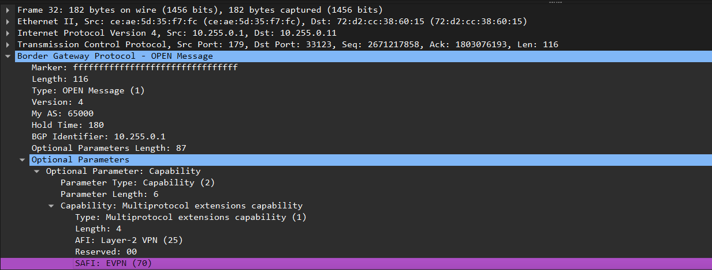
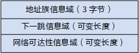
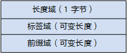
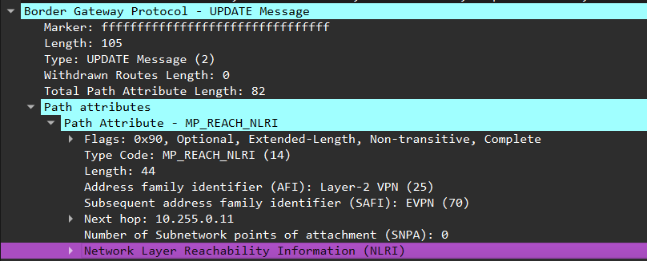
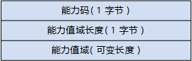

### 1. mp-bgp描述

传统的BGP-4只能管理IPv4单播路由信息，对于使用其它网络层协议（如IPv6、组播等）的应用就受到一定限制。

为了提供对多种网络层协议的支持，IETF（Internet Engineering Task Force）对BGP-4进行了扩展，形成MP-BGP（Multi-protocol Extensions for Border Gateway Protocol），目前的MP-BGP标准是RFC4760（Multiprotocol Extensions for BGP-4，BGP-4的多协议扩展）。MP-BGP向前兼容，即支持BGP扩展的设备与不支持BGP扩展的设备可以互通。

- MP-BGP在现有BGP-4协议的基础上增强功能，使BGP能够为多种路由协议提供路由信息，包括IPv6（即BGP4+）和组播。

- MP-BGP可以同时为单播和组播维护路由信息，将它们储存在不同的路由表中，保持单播和组播之间路由信息相互隔离。

- MP-BGP可以同时支持单播和组播模式，为两种模式构建不同的网络拓扑结构。

原BGP-4支持的单播路由策略和配置方法大部分都可应用于组播模式，从而根据路由策略为单播和组播维护不同的路由。

### 2. mp-bgp通过open报文进行能力协商

双方在 **OPEN 消息中通过 Multiprotocol Capability 协商 AFI/SAFI**；它属于 OPEN 的能力参数。

BGP设备通过Open消息协商能力，通过查看Open消息中的能力参数来确定对等体所具有的能力。BGP设备如果支持某功能，并且确定对方也具备该能力，那么该BGP设备将使用该功能与对等体交互。

Open消息包含可选的能力协商参数Capabilities，由一个或多个三元组<Parameter Type、Parameter Length、Parameter Value>组成。其格式如图10-19。

图10-19  BGP可选能力协商参数格式

- 能力码（Capability Code）：唯一标识了该能力的类型。该值为1表示BGP Speaker具备MP-BGP能力。

- 能力值域长度（Capability Length）：表示能力值域的长度。MP-BGP能力参数中，能力值域的长度为4。

- 能力值域（Capability Value）：长度决定于Capability Code。MP-BGP能力参数中，能力值域的格式如图10-20。其中，

  - AFI（2字节）和SAFI（1字节）的含义与MP_REACH_NLRI中的相同。

  - Res.为保留域（1字节）。发送方应将其置0；接收方应忽略该域信息。

图10-20  MP-BGP能力值域的格式

目前BGP不支持动态能力协商。BGP Speaker发布了一个携带可选能力参数后，

- 如果收到对端回应的Notification消息，表明对端不支持能力发布。此时BGP Speaker将中断与该对等体的会话，发送一个不携带任何可选能力参数的Open消息，试图重新建立BGP连接。

- 如果对端支持能力发布，但该可选能力参数是未知的或不支持的，则协商失败。此时BGP Speaker将中断与该对等体的会话，发送一个不携带该可选能力参数的Open消息（可能还携带其他可选能力参数），试图重新建立BGP连接。

因此BGP能力的变化，如使能或禁止标签路由能力、使能或禁止某地址族能力（如IPv4、IPv6、VPNv4、VPNv6）、使能GR能力等，BGP Speaker都会中断与该对等体的会话，之后重新进行对等体能力协商。

#### 2.1 地址族(AFI)

BGP采用地址族（Address Family）来区分不同的网络层协议，交换机实现多种MP-BGP扩展应用，不同的扩展应在各自的地址族视图下配置

**AFI 标识地址类型，SAFI 进一步区分用途；两者共同确定 BGP 地址族。** 下表数值均为十进制。

| 地址族 / 业务 | AFI | SAFI | 携带的信息或用途 |
|---|---:|---:|---|
| IPv4 单播 | 1 | 1 | IPv4 单播路由 |
| IPv4 组播 | 1 | 2 | 用于组播转发的 IPv4 路由信息 |
| IPv4 标签单播（BGP-LU） | 1 | 4 | IPv4 前缀及 MPLS 标签 |
| IPv4 MVPN | 1 | 5 | IPv4 组播 VPN 控制信息 |
| IPv4 MDT | 1 | 66 | 组播分发树相关信息 |
| VPNv4 | 1 | 128 | 带 RD 的 IPv4 VPN 路由 |
| RT-Constrain（RTC） | 1 | 132 | RT 成员信息，用于约束 VPN 路由分发 |
| IPv4 FlowSpec | 1 | 133 | IPv4 流量匹配规则 |
| VPNv4 FlowSpec | 1 | 134 | IPv4 VPN 流量匹配规则 |
| IPv6 单播 | 2 | 1 | IPv6 单播路由 |
| IPv6 组播 | 2 | 2 | 用于组播转发的 IPv6 路由信息 |
| IPv6 标签单播（BGP-LU） | 2 | 4 | IPv6 前缀及 MPLS 标签，例如 6PE |
| VPNv6 | 2 | 128 | 带 RD 的 IPv6 VPN 路由 |
| L2VPN VPLS | 25 | 65 | VPLS 的自动发现及相关信令 |
| **L2VPN EVPN** | **25** | **70** | **EVPN 路由，包括 MAC/IP、IMET、IP 前缀等** |
| BGP-LS | 16388 | 71 | 链路状态和流量工程拓扑信息 |
| BGP-LS-VPN | 16388 | 72 | 带 VPN 区分信息的链路状态信息 |

### 3. mp-bgp对update消息拓展的属性

**MP-BGP 继续使用 BGP UPDATE 消息，主要新增两个路径属性：`MP_REACH_NLRI`(14)和 `MP_UNREACH_NLRI`(15)**

为实现对多种网络层协议的支持，BGP-4需要将网络层协议的信息反映到NLRI及Next_Hop。MP-BGP中引入了两个新的路径属性：

- MP_REACH_NLRI：Multiprotocol Reachable NLRI，多协议可达NLRI。用于发布可达路由及下一跳信息。

- MP_UNREACH_NLRI：Multiprotocol Unreachable NLRI，多协议不可达NLRI。用于撤销不可达路由。

这两种属性都是可选非过渡（Optional non-transitive）的，因此，不提供多协议能力的BGP Speaker将忽略这两个属性的信息，不把它们传递给其它邻居

#### 3.1 MP_REACH_NLRI报文格式

MP_REACH_NLRI用于发布可达路由及下一跳信息。该属性由一个或多个三元组<地址族信息、下一跳信息、网络可达性信息>组成，格式如下：

图10-16  MP_REACH_NLRI属性的格式

- 地址族信息（Address Family Information）域：由2字节的地址族标识AFI（Address Family Identifier）和1字节的子地址族标识SAFI（Subsequent Address Family Identifier）组成。

  - AFI标识网络层协议，对应RFC1700的“Address Family Number”所定义的地址族值。例如IPv4的值是1，IPv6的值是2。

  - SAFI表示NLRI的类型。

    AFI值为1，SAFI值为128表示NLRI中的地址为BGP-VPNv4地址族。

- 下一跳信息（Next Hop Network Address Information）域：由一字节的下一跳网络地址长度和可变长度的下一跳网络地址组成。下一跳网络地址是指去往目的系统的路径上的下一个设备网络地址。

- 网络层可达性信息（NLRI）域：由一个或多个三元组<长度、标签、前缀>组成。其格式如下：

  图10-17  携带标签的NLRI格式

  

  - 长度域：标签域和前缀域的总比特数。

  - 标签域：标签域由一个或多个标签组成，每个标签长度为3字节。

  - 前缀域：在BGP/MPLS IP VPN中，前缀域由RD（Route Distinguisher）和IPv4地址前缀组成。

当两个PE或ASBR（Autonomous System Boundary Router）之间交换VPN路由信息时，在Update消息中携带MP_REACH_NLRI属性。一个Update消息可以携带多条具有相同路由属性的可达路由信息。  

### 3.2 MP_UNREACH_NLRI报文格式

MP_UNREACH_NLRI用于通知对等体删除不可达的路由。该属性的格式如下：

图10-18  MP_UNREACH_NLRI属性的格式

- 地址族标识AFI：与MP_REACH_NLRI属性中的相同，用于标识网络层协议，对应RFC1700的“Address Family Number”所定义的地址族值。

- 子地址族标识SAFI：与MP_REACH_NLRI属性中的相同，表示NLRI的类型。

- 撤销路由（Withdrawn Routes）：不可达路由列表，也是由一个或多个NLRI组成。BGP Speaker可以通过在撤销路由域中携带与之前发布的可达路由中相同的NLRI来撤销路由。

BGP Speaker通过携带MP_UNREACH_NLRI属性的Update消息来撤销路由。一个Update消息可以携带多条不可达路由信息。

当撤销路由时，如果指定了标签，只有指定了标签的路由被撤销；如果没有指定标签，只有不带标签的路由被撤销。

携带MP_UNREACH_NLRI属性的Update消息不再携带路径属性。

