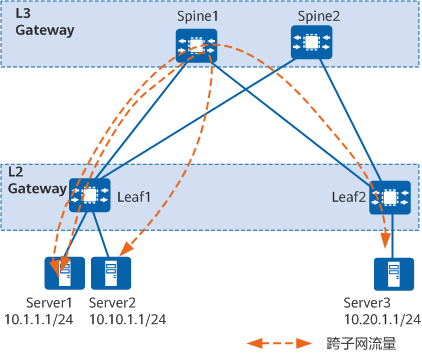
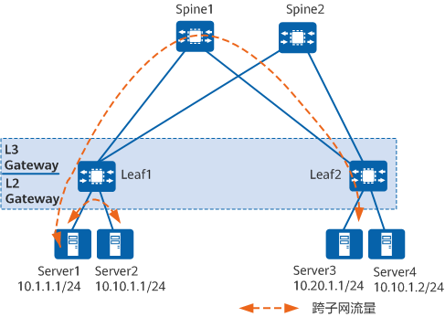
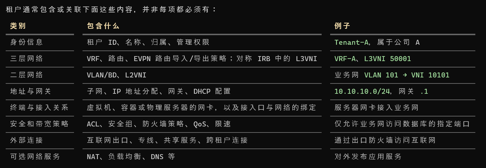
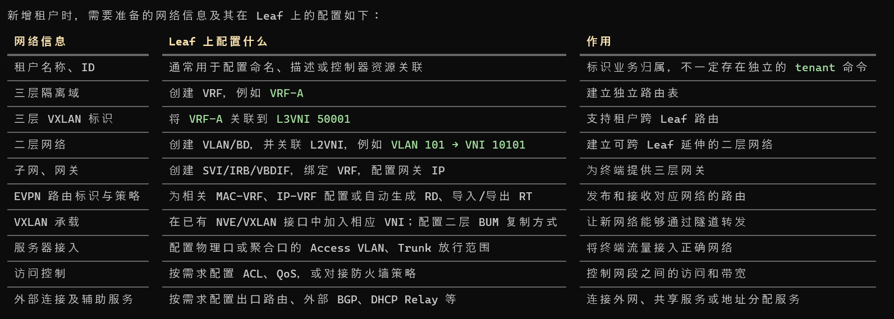

### 1. vxlan网关划分

和VLAN类似，不同VNI之间的VXLAN，及VXLAN和非VXLAN之间不能直接相互通信。为了使VXLAN之间，以及VXLAN和非VXLAN之间能够进行通信，VXLAN引入了VXLAN网关。

VXLAN网关分为：

  - 二层网关：用于解决租户接入VXLAN虚拟网络的问题，也可用于同一VXLAN虚拟网络的子网通信。
  - 三层网关：用于VXLAN虚拟网络的跨子网通信以及外部网络的访问。

根据三层网关部署方式的不同，VXLAN三层网关又可以分为集中式网关和分布式网关。

#### 1.1 集中式网关

集中式网关是指将三层网关集中部署在一台设备上，如图2-5所示，所有跨子网的流量都经过三层网关进行转发，实现流量的集中管理。

图2-5 VXLAN集中式网关组网图



部署集中式网关的优点和缺点如下：
- 优点：对跨子网流量进行集中管理，网关的部署和管理比较简单。
- 缺点：
  - 转发路径不是最优：同一二层网关下跨子网的数据中心三层流量都需要经过集中三层网关转发。
  - ARP表项规格瓶颈：由于采用集中三层网关，通过三层网关转发的终端租户的ARP表项都需要在三层网关上生成，而三层网关上的ARP表项规格有限，这不利于数据中心网络的扩展。

#### 1.2 分布式网关

通过部署分布式网关可以解决集中式网关部署的缺点。VXLAN分布式网关是指在典型的`“Spine-Leaf”`组网结构下，将Leaf节点作为VXLAN隧道端点VTEP，每个Leaf节点都可作为VXLAN三层网关，Spine节点不感知VXLAN隧道，只作为VXLAN报文的转发节点。如图2-6所示，Server1和Server2不在同一个网段，但是都连接到一个Leaf节点。Server1和Server2通信时，流量只需要在Leaf1节点进行转发，不再需要经过Spine节点。

图2-6 VXLAN分布式网关示意图



Spine节点：关注于高速IP转发，强调的是设备的高速转发能力。

Leaf节点：
- 作为VXLAN网络中的二层网关设备，与物理服务器或VM对接，用于解决终端租户接入VXLAN虚拟网络的问题。
- 作为VXLAN网络中的三层网关设备，进行VXLAN报文封装/解封装，实现跨子网的终端租户通信，以及外部网络的访问。

分布式网关的特点
- 同一个Leaf节点既可以做VXLAN二层网关，也可以做VXLAN三层网关，部署灵活。
- Leaf节点只需要学习自身连接服务器的ARP表项，而不必像集中三层网关一样，需要学习所有服务器的ARP表项，解决了集中式三层网关带来的ARP表项瓶颈问题，网络规模扩展能力强。

### 2 leaf 内部组网(vxlan分布式网关)

#### 2.1 租户概念(Tenant)

租户（Tenant）是按客户、部门或项目划分的一组逻辑网络资源，以及这些资源的管理、隔离和访问策略。通常租户都是使用Leaf上的资源组成的。

例如，公司 A 和公司 B 共用一套交换机，但各自拥有自己的网段、网关、路由和访问规则，就可以在Leaf上划分为两个租户。



其中，安全组、NAT、负载均衡等可能由云平台或其他设备实现，**不一定都配置在 Leaf 上**。租户通常包含或关联下面这些内容，并非每项都必须有。

几个概念之间的关系是：

- **租户**：资源归谁、由谁管理、允许与谁通信。
- **VRF**：把三层路由空间分开。
- **VLAN/BD**：划分二层广播域 (linux用bridge, 路由器用bd来标识二层网络), VNI和BD(bridge)是一一对应的。
- **VNI**：在 VXLAN 中标识对应的二层或三层网络(L2VNI | L3VNI)。

L2VNI作用: 是延申二层网络

L3VNI作用: 是承载租户跨 Leaf 的三层路由流量

一个租户可以有多个 VRF，一个 VRF 可以关联多个二层网络和子网。\*\*例如公司 A 可以再划分生产 VRF 和测试 VRF，所以不能把“一个租户”固定理解成“一个 VLAN”或“一个 VNI”。

另外，`Leaf、Spine、底层链路和 VTEP 地址通常属于共享基础设施。新增租户时，主要是在这些设备上增加逻辑网络配置`；终端的 MAC、ARP/ND 和远端路由等运行状态，则通常通过学习或协议交互产生。

Leaf上租户控制的几种网络情况:

同网段的 PC 如果接在同一台 Leaf 上，通常直接本地交换，不需要 VXLAN 封装；跨 Leaf 时，才通过对应的 L2VNI 承载 (这种就是大二层网络)。

以下假设：**同一租户、同一 VRF，网关部署在 Leaf 上，采用对称 IRB**；同子网的终端位于同一二层域，讨论地址已经学习完成后的正常单播转发。

租户网络场景

```
1. 同一租户、同一 VRF
   1.1 同 Leaf、同子网：本地二层交换
   1.2 同 Leaf、不同子网：本地三层路由
   1.3 跨 Leaf、同子网：L2VNI
   1.4 跨 Leaf、不同子网：L3VNI（对称 IRB）

2. 同一租户、不同 VRF
   需要配置跨 VRF 路由互通或经过防火墙，并满足访问策略

3. 不同租户
   按隔离设计默认不互通；共享服务等场景需要显式配置互通

4. 租户访问外部网络
   经 Border Leaf / 出口网关，按设计对接防火墙、NAT、专线等

5. Leaf 之间的底层网络
   属于 Underlay，负责 VTEP 地址可达，通常由多个租户共
```

假设Leaf的网络配置如下：

```
抽象租户组网:

Tenant-A
└── VRF-A：L3VNI 5000
    ├── 子网 A：10.10.10.0/24，VLAN 10，L2VNI 100
    └── 子网 B：10.10.20.0/24，VLAN 20，L2VNI 200

这里，**L2VNI 标识二层广播域，L3VNI 在对称 IRB 中关联 VRF，用于跨 Leaf 的三层转发**。不同 VRF 可以使用重叠的 IP 地址空间

linux示例:

l2vni --- 租户vrf --- l2vni(vxlan的二层网桥)

PC1 ── host10 ── br100 ─────────── vx100
                   │              L2VNI 100
                   │
               TENANT-A ── br500 ─ vx500
                   │              L3VNI 500
                   │
                 br200 ─────────── vx10020
                                  L2VNI 200

路由器示例:

l2vni --- 租户vrf --- l2vni(vxlan的二层网桥)

PC1 ── host10 ── bd100 ─────────── vx100
                   │              L2VNI 100
                   │
               TENANT-A ── bd500 ─ vx500
                   │              L3VNI 500
                   │
                 bd200 ─────────── vx10020
                                  L2VNI 200                               
```

| 通信场景 | 实际转发过程 | VXLAN 封装使用哪个 VNI | 是否经过 Spine |
|---|---|---|---|
| 同一 Leaf、同一子网 | Leaf 在对应 VLAN/BD 内查 MAC 表，直接交换 | 不需要 VXLAN 封装 | 不需要 |
| 同一 Leaf、不同子网 | Leaf 在 VRF-A 内查路由，转发到目标子网 | 不需要 VXLAN 封装 | 不需要 |
| 不同 Leaf、同一子网 A | 源 Leaf 封装，目标 Leaf 解封装后交换 | **L2VNI 100** | 常规拓扑下需要 |
| 不同 Leaf、不同子网 | 源 Leaf 路由并封装，目标 Leaf 解封装后再次路由 | **L3VNI 5000** | 常规拓扑下需要 |

**跨 Leaf、同子网的路径：**

```
PC1：10.10.10.11
  ↓ 普通以太网帧
Leaf1：在 VLAN 10 / BD 中查 MAC，发现目的位于 Leaf2
  ↓ VXLAN 封装，VNI = 100
Spine：按外层目的 IP，转发到 Leaf2
  ↓
Leaf2：解封装，VNI 100 对应本地 VLAN 10 / BD
  ↓ 查 MAC，交付终端
PC2：10.10.10.22
```

这里是二层互通，PC1 的业务报文不需要经过默认网关进行路由。

**跨 Leaf、不同子网的路径：**

```
PC1：10.10.10.11
  ↓ 发给子网 A 的默认网关
Leaf1：在 VRF-A 中查路由，确定下一跳为 Leaf2
  ↓ VXLAN 封装，VNI = 5000
Spine：按外层目的 IP，转发到 Leaf2
  ↓
Leaf2：解封装，VNI 5000 对应 VRF-A
  ↓ 在 VRF-A 中查路由，经子网 B 的接口转发
PC3：10.10.20.22
```

**这段跨 Leaf 的隧道报文携带的是 L3VNI 5000，目的 Leaf 再将它转发到 VLAN 20；并不是在隧道里同时套上 L2VNI 100、L3VNI 5000、L2VNI 200 三层。**[NVIDIA 对称 IRB 转发流程](<https://developer.nvidia.com/blog/using-vxlan-routing-with-evpn-through-asymmetric-or-symmetric-models/>)

新增租户时，需要准备的网络信息及其在 Leaf 上的配置如下：

