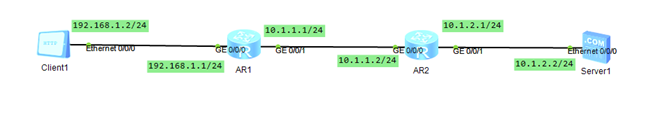

#### 1. ftp alg实现



```
ftp分为控制连接和数据连接, ftp只需要对active模式的控制连接做nat alg就行,
本质维护一个alg-gateway 和 server之间的一个seq初始值问题(因为port命令做nat alg后会导致下一次发起的seq的偏移会发生改变, 但是client还是用旧的seq发起的, 所以需要alg-gateway来每次更新seq的初始值), 在alg和server之间维护新的窗口

控制连接:(数据连接是新的tcp连接所以不需要管)
第一个port报文保存: alg-update-value = (new-payload-len[new port报文长度] - client-port-len[old port报文长度])
后续所有client发起的request, alg更新seq: alg-new-seq = client-seq + alg-update-value

client  --- alg-gateway --- server

主动模式和被动模式就是哪端先发起建立数据连接的tcp连接, 服务器发起认为是主动, 客户端发起是被动
主动模式:
    客户端通过port告诉服务器发起数据连接的ip和port
    所以主动模式需要对应用层的port的内容做nat alg
被动模式:
	服务器通过pasv response告诉client发起数据连接的ip和port
	所以被动模式需要改的是ip报文, 对sip做snat

主动模式: alg gateway 对控制连接的port报文做nat alg和维护后续的seq
被动模式: gateway 对控制连接和数据连接做snat
```
https://blog.csdn.net/muxia_jhy/article/details/86557977

主动模式测试报文 client: [client pcap](../../../../pcap/vpp/plugins/nat/ftp_active_alg_before.pcapng)

主动模式测试报文 alg-agent: [alg pcap](../../../../pcap/vpp/plugins/nat/ftp_active_alg_after.pcapng)

被动模式测试报文 client: [client pcap](../../../../pcap/vpp/plugins/nat/ftp_pasv_alg_before.pcapng)

被动模式测试报文 snat-agent: [snat pcap](../../../../pcap/vpp/plugins/nat/ftp_pasv_alg_after.pcapng)