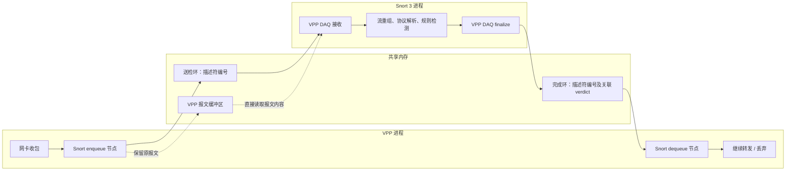
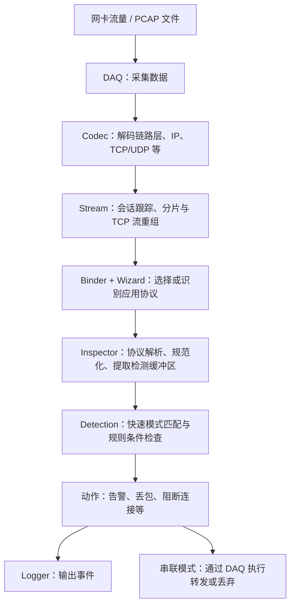
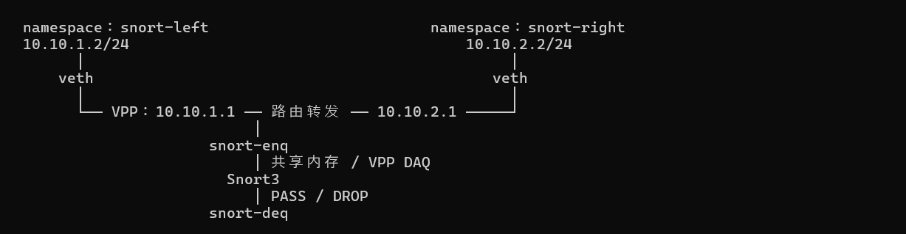
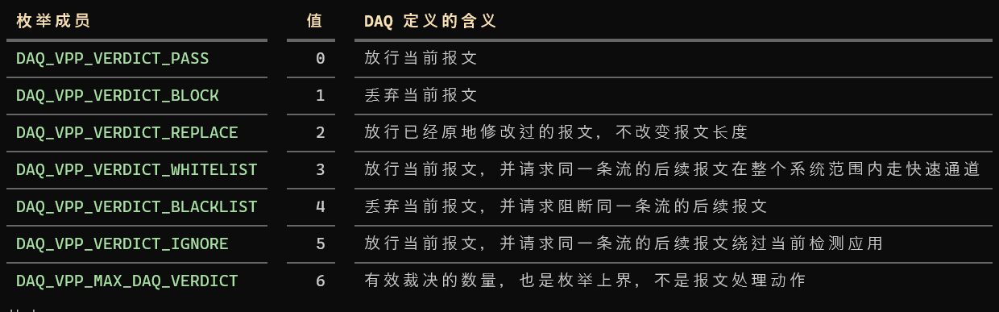

### 1. snort架构

#### 1.1 vpp和snort进程间通信架构



#### 1.2 snort处理vpp的报文



### 2. 安装snort

```
sudo apt update
sudo apt install -y software-properties-common
sudo add-apt-repository -y universe
sudo apt update
# 安装Hyperscan, 加速snort3的正则匹配
sudo apt install -y libhyperscan-dev

sudo apt install -y \
  build-essential cmake git ca-certificates pkg-config \
  autoconf automake libtool flex bison libfl-dev \
  libpcap-dev libpcre2-dev libdumbnet-dev \
  libhwloc-dev libluajit-5.1-dev \
  libssl-dev zlib1g-dev liblzma-dev \
  libunwind-dev uuid-dev libnuma-dev \
  libmnl-dev libnetfilter-queue-dev

# 安装snort3
git clone https://github.com/snort3/snort3.git
git checkout -b 3.12.2.0 3.12.2.0

cd snort3

bash ./configure_cmake.sh \
  --prefix=/usr/local \
  --build-type=Release \
  --with-daq-includes=/usr/local/include \
  --with-daq-libraries=/usr/local/lib \
  --disable-static-daq \
  --disable-docs

cmake --build build -j"$(nproc)"
sudo cmake --install build
sudo ldconfig

/usr/local/bin/snort -V
```

### 3. 测试拓扑



### 4. 测试命令

```bash
apt install -y iputils-ping

ip -n snort-left link show lo >/dev/null 2>&1 || ip netns add snort-left
ip -n snort-right link show lo >/dev/null 2>&1 || ip netns add snort-right

if ! ip link show vsnl >/dev/null 2>&1; then
    ip link add vsnl type veth peer name nsnl
    ip link set nsnl netns snort-left
fi

if ! ip link show vsnr >/dev/null 2>&1; then
    ip link add vsnr type veth peer name nsnr
    ip link set nsnr netns snort-right
fi

ip link set vsnl up
ip link set vsnr up

ip -n snort-left link set lo up
ip -n snort-left link set nsnl up
ip -n snort-left addr replace 10.10.1.2/24 dev nsnl
ip -n snort-left route replace default via 10.10.1.1

ip -n snort-right link set lo up
ip -n snort-right link set nsnr up
ip -n snort-right addr replace 10.10.2.2/24 dev nsnr
ip -n snort-right route replace default via 10.10.2.1

# 2. vppctl：创建或复用接口，配置地址和 Snort 挂接

vppctl show interface | grep -qw host-vsnl ||
    vppctl create host-interface name vsnl

vppctl show interface | grep -qw host-vsnr ||
    vppctl create host-interface name vsnr

# 挂接前必须 down
vppctl set interface state host-vsnl down
vppctl set interface state host-vsnr down

vppctl show interface address host-vsnl | grep -Fq '10.10.1.1/24' ||
    vppctl set interface ip address host-vsnl 10.10.1.1/24

vppctl show interface address host-vsnr | grep -Fq '10.10.2.1/24' ||
    vppctl set interface ip address host-vsnr 10.10.2.1/24

# 已存在 lab 时直接复用
vppctl show snort instances | grep -q '^instance: lab ' ||
    vppctl snort create-instance name lab queue-size 1024 on-disconnect pass

# 两个接口都挂入方向，覆盖两个方向的流量
vppctl snort attach instance lab interface host-vsnl input
vppctl snort attach instance lab interface host-vsnr input

vppctl set interface state host-vsnl up
vppctl set interface state host-vsnr up

vppctl show interface address
vppctl show snort interfaces
vppctl show snort clients

# 当前 lab 为 on-disconnect pass，Snort 未连接时应能通
ip netns exec snort-left ping -c 3 -W 1 10.10.2.2
ip netns exec snort-right ping -c 3 -W 1 10.10.1.2

# 启动snort进程
/usr/local/bin/snort \
  -c /usr/local/etc/snort/snort.lua \
  --daq-dir /opt/vpp/build-root/install-vpp-native/vpp/lib64/daq \
  --daq vpp \
  --daq-var socket=/run/vpp/snort.sock \
  -i lab \
  -Q -A alert_fast -k none \
  --lua 'ips.rules = [[
drop icmp 10.10.1.2 any -> 10.10.2.2 any (msg:"VPP SNORT DROP ICMP"; itype:8; sid:1000001; rev:1;)
]]; alert_fast = {file = false}'

# 10.10.1.2 -> 10.10.2.2 的icmp报文都会丢弃;
ip netns exec snort-left ping -c 3 -W 1 10.10.2.2

# 放行流量
ip netns exec snort-right ping -c 3 -W 1 10.10.1.2
```

### 5. 结果分析

[snort-af-packet.pcap](../../../pcap/vpp/plugins/snort/snort-af-packet.pcap)

#### 5.1 snort处理结果



#### 5.2 10.10.1.2 访问 10.10.2.2
```
# 10.10.1.2 -> 10.10.2.2 默认snort规则会丢弃

23:13:20:365936: af-packet-input
  af_packet: hw_if_index 3 rx-queue 0 next-index 4
    block 151:
      address 0x70c751770000 version 2 seq_num 152 pkt_num 0
    tpacket3_hdr:
      status 0x20000001 len 98 snaplen 98 mac 92 net 106
      sec 0x6ad6d047 nsec 0xa5e1bb7 vlan 0 vlan_tpid 0
    vnet-hdr:
      flags 0x00 gso_type 0x00 hdr_len 0
      gso_size 0 csum_start 0 csum_offset 0
23:13:20:365941: ethernet-input
  IP4: 9a:8b:40:3f:a7:52 -> 02:fe:4d:bc:70:af
23:13:20:365944: ip4-input
  ICMP: 10.10.1.2 -> 10.10.2.2
    tos 0x00, ttl 64, length 84, checksum 0xe306 dscp CS0 ecn NON_ECN
    fragment id 0x408b, flags DONT_FRAGMENT
  ICMP echo_request checksum 0x8b4 id 46997
23:13:20:365948: snort-ip4-input
  sw-if-index 3 instance 0
23:13:20:365949: snort-enq
  sw-if-index 3 next-index 1
  instance 0 qpair 1.0
  desc: buffer-pool 0 offset 1072220558 len 84
  metadata: address-space-id 0 flags 0x4 ingress_index 0
23:13:20:366193: snort-deq-lab
  snort-deq: sw_if_index 3, next index 0
   buffer index 16753442, verdict BLOCK
```

#### 5.1 10.10.2.2 访问 10.10.1.2

```
23:21:26:132180: af-packet-input
  af_packet: hw_if_index 4 rx-queue 0 next-index 4
    block 130:
      address 0x70c74ca20000 version 2 seq_num 131 pkt_num 0
    tpacket3_hdr:
      status 0x1 len 98 snaplen 98 mac 92 net 106
      sec 0x6ad6d22c nsec 0x276b809b vlan 0 vlan_tpid 0
    vnet-hdr:
      flags 0x00 gso_type 0x00 hdr_len 0
      gso_size 0 csum_start 0 csum_offset 0
23:21:26:132187: ethernet-input
  IP4: d2:ed:de:6b:52:4c -> 02:fe:14:9d:a1:b8
23:21:26:132193: ip4-input
  ICMP: 10.10.2.2 -> 10.10.1.2
    tos 0x00, ttl 64, length 84, checksum 0x160d dscp CS0 ecn NON_ECN
    fragment id 0x0d85, flags DONT_FRAGMENT
  ICMP echo_request checksum 0x263f id 47000
23:21:26:132197: snort-ip4-input
  sw-if-index 4 instance 0
23:21:26:132198: snort-enq
  sw-if-index 4 next-index 1
  instance 0 qpair 1.0
  desc: buffer-pool 0 offset 1072225550 len 84
  metadata: address-space-id 0 flags 0x4 ingress_index 0
23:21:26:132325: snort-deq-lab
  snort-deq: sw_if_index 4, next index 1
   buffer index 16753520, verdict PASS
23:21:26:132325: snort-ip4-input-next
  buffer-index 16753520 next_index 1
23:21:26:132332: host-vsnl-tx
  af_packet: hw_if_index 3 tx-queue 0
    tpacket3_hdr:
      status 0x1 len 108 snaplen 108 mac 0 net 0
      sec 0x0 nsec 0x0 vlan 0 vlan_tpid 0
    vnet-hdr:
      flags 0x00 gso_type 0x00 hdr_len 0
      gso_size 0 csum_start 0 csum_offset 0
    buffer 0xffa370:
      current data 0, length 98, buffer-pool 0, ref-count 1, trace handle 0x1000000
      l2-hdr-offset 0 l3-hdr-offset 14
    IP4: 02:fe:4d:bc:70:af -> 9a:8b:40:3f:a7:52
    ICMP: 10.10.2.2 -> 10.10.1.2
      tos 0x00, ttl 63, length 84, checksum 0x170d dscp CS0 ecn NON_ECN
      fragment id 0x0d85, flags DONT_FRAGMENT
    ICMP echo_request checksum 0x263f id 47000
```