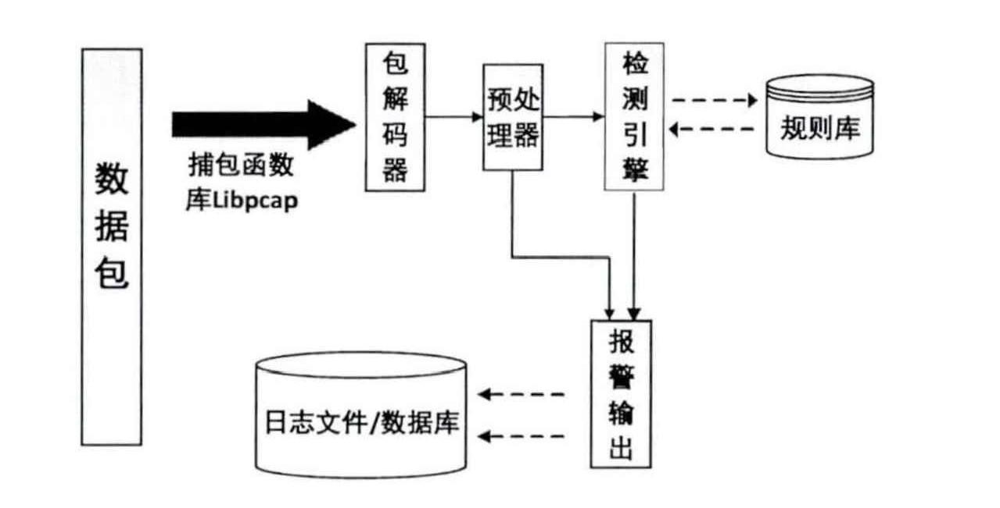
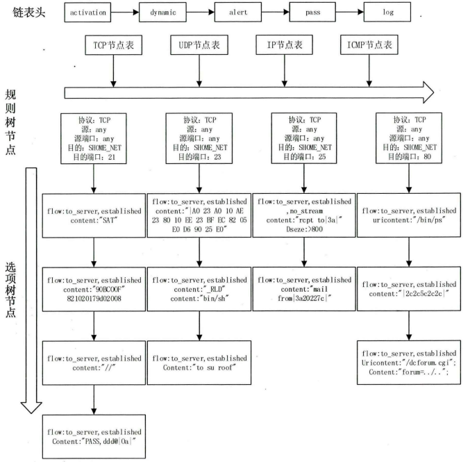

### 1. snort简介

1. Snort是世界最顶尖的开源入侵检测系统
2. Snort IDS利用一系列的规则去定义恶意网络活动，against匹配到的报文并给用户告警
3. Snort主要用法，第一种类似TCP dump，作为网络sniffer使用，调试网络流量，第二种用于特征识别的网络入侵检测
4. 线上Snort规则一种是免费的社区规则，一种是付费的订阅（Cisco Talos）

### 2. snort架构

- 解码器：将捕获的数据包解码后存放到snort定义的结构体中（./decode.h sturct Packet），目前支持的协议有IP，TCP，UDP等
- 预处理器：基于插件形式，对数据包进行修改，包括分片重组，分段重组，端口扫描预处理器
- 检测引擎：规则建立（多维链表）+规则匹配
  - 包括数据包相关各种特征的描述选项，比如：content、flags、dsize、ttl等；
  - 规则本身相关一些说明选项，比如：reference、sid、classtype、priority等；
  - 规则匹配后的动作选项，比如：msg、resp、react、session、logto、tag等；
  - 选项是对某些选项的修饰，比如从属于content的nocase、offset、depth、regex等
- 规则相关
- 报警输出：将检测引擎处理后的数据包送到系统日志文件或产生告警。日志文件可以是ascii格式或者tcpdump的二进制格式或到数据库中，当然有输出模块也是以插件形式，用户可定制按需定制

### 3. 规则配置

